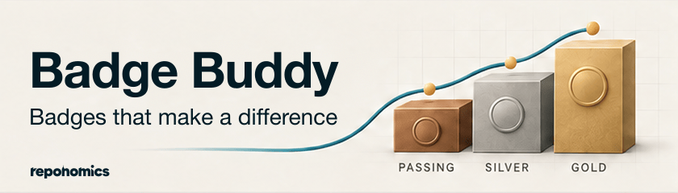

# Badge Buddy

<picture>
  <source media="(prefers-color-scheme: dark)" srcset="docs/assets/badge-buddy/badge-buddy-dark-840x240.png">
  
</picture>

Badge Buddy helps maintainers work through the [OpenSSF Best Practices](https://www.bestpractices.dev/) badge application, understand its criteria, and improve their projects. It also explains [OpenSSF Scorecard](https://scorecard.dev/) results, helps maintain GitHub Actions workflows, establishes useful test-coverage baselines, and configures static analysis.

> [!NOTE]
> Badge Buddy is an independent community project. It is not affiliated with or endorsed by the Open Source Security Foundation (OpenSSF) or The Linux Foundation.

## Get started

Install [uv](https://docs.astral.sh/uv/getting-started/installation/) so `uvx` is available to Claude Code, and have Python 3.11 or newer available as `python3`. The plugin registers the [Best Practices MCP](https://github.com/reponomics/best-practices-mcp) server, pinned to an exact version in [`.mcp.json`](.mcp.json), which handles every exchange with the badge website and keeps your draft answers. The local board renderer and the Scorecard helper use only Python's standard library; the board reads its criterion text from the same server.

This repository is its own plugin marketplace. Add it and install the plugin in Claude Code:

```sh
claude plugin marketplace add reponomics/badge-buddy
claude plugin install badge-buddy@badge-buddy
```

This follows the repository's `main` branch. To install one specific release and check its signature, see [Verifying a release](docs/release/verification.md).

Ask for the help you need:

- “Help me fill out the OpenSSF Best Practices application.”
- “What does this Silver criterion mean for my project?”
- “Show me my current answers.”
- “Help me implement this missing practice.”

Badge Buddy covers Passing, Silver, Gold, and Security Baseline levels 1–3. You can ask questions, prepare answers, or work on the project as the conversation develops. For a new application, [register your project](https://www.bestpractices.dev/projects/new) on the badge website. Registration is not needed for explanations or implementation help, and you can ask to prepare answers before registering.

Reload plugins or restart Claude Code after installation, then check with `/mcp` that the plugin's `bestpractices` server is connected. It is started with `uvx`, reads only public badge data, and needs no BadgeApp credentials. If you already use the same server on its own, both can run side by side and share the same drafts.

## Preparing answers

The application is yours, and you decide what to record and submit. The badge is self-reported, and Claude works with you in good faith: it takes your account of your project at your word, including things it cannot independently verify. It uses the official criterion text, the repository, and what you tell it to help draft answers and supply any required links or explanations. If something appears inconsistent with the facts or a criterion, it assumes clarification is needed, explains the discrepancy, and helps you work through it, allowing for context it may have missed.

A second agent reviews Claude's work before Claude presents its drafted answers or revisions to you. It checks whether Claude understood the criteria, wrote clearly, represented your account faithfully, and respected your instructions and control of the form. Your answers provide context for that review; the reviewer has no role in approving your application or vetting your honesty. You can skip the review or stop at any time. See the [peer review instructions](skills/ossf-bp-badges/references/peer-review.md).

For the Metal badges, a response and its effect on badge progress are distinct:

- Applicable `MUST` and `MUST NOT` requirements must be satisfied.
- An absent `SHOULD` practice is `Unmet`. It can still count toward the badge when accompanied by an adequate rationale.
- An absent `SUGGESTED` practice is also `Unmet`; answering it satisfies the badge's requirement to consider the practice.

`Met` means the practice is implemented. Unknown answers remain `?`, and `N/A` follows the criterion's applicability rules. You can save and submit an application with work still to do.

## Saving and reviewing progress

Claude records the answers you are preparing in a draft kept by the MCP server on your machine, one `.bestpractices.json` per project, outside your repository. This lets you resume later without adding files to your repository; Claude tells you where the draft is saved. The server's [README](https://github.com/reponomics/best-practices-mcp#optional-draft-storage) lists the default locations and how to change them. At the start of a session, Claude reads the answers saved on the badge website for the level you are working on and adds any the draft lacks, so the draft is a single file holding your whole application. Your unsaved changes are kept, and Claude raises any differences from the website with you.

Ask to preview your answers to open a local board. It shows the official criteria, your answers and justifications, and evidence links. Each board covers one badge section. You can read all criteria together or choose a response category such as Unmet. A table of contents helps you move through the list.

Claude renders the board again as your answers change, and the open page reloads to show the result. Reading or navigating it does not change an answer. Discuss revisions in the conversation. During an interactive revision, Claude updates the justification first and keeps the response unchanged while you review the wording. After you approve it, Claude updates the response. Initial drafts can include both together.

## Submitting answers

When your answers are ready, Claude prepares a proposal URL. Opening it shows your proposed answers in the official edit form, with changes highlighted for review. Nothing is saved by opening the link, and Claude includes only the answers that differ from what the website already has.

You review and save the website form. Claude may help with login or saving only when you explicitly ask it to perform that action. The MCP server does not authenticate or write to the badge site. A few edits cannot be proposed through a link, such as resetting an answer to unknown or wording too long for a URL; Claude gives you the text to enter in the form. See the [submission guide](skills/ossf-bp-badges/references/application.md#website-transfers) for details.

The badge site can also import answers from a `.bestpractices.json` committed to your repository. The site reads the file after it is pushed and uses it to fill unanswered criteria, which lets a new project start from another project's answers. It does not replace answers you have already saved. If you keep that file or want to reuse answers this way, tell Claude: it prepares changes in a temporary copy, shows them to you before writing back, and checks for intervening edits. Committing and pushing remain your choice.

## OpenSSF Scorecard

Ask **“Explain my Scorecard findings”**, **“Set up a Scorecard badge”**, or **“Fix the unpinned actions reported by Scorecard.”** The [Scorecard skill](skills/ossf-scorecard/SKILL.md) reads published results, investigates findings, and helps implement improvements. It can configure the official Scorecard Action when you want to publish results. An existing public result may already support a badge without adding an Action.

Install the full [OpenSSF Scorecard executable](https://github.com/ossf/scorecard/releases/tag/v5.7.0) before using the integrated Scorecard workflow. Badge Buddy starts its `scorecard mcp` server for published-result queries and uses the same executable's CLI for fresh selected scans and supported local checks. Version **5.7.0** is the tested baseline; your installed binary is not automatically pinned or updated by the plugin. See [Scorecard setup](skills/ossf-scorecard/references/installation.md) for installation, absolute-path configuration, and connection troubleshooting. Best Practices and the other engineering skills do not require Scorecard.

Published queries need no GitHub token and return existing measurements; they do not start scans. Fresh remote diagnostics may need credentials, while local checks examine only supported files and cannot assess all remote settings or history. After changes reach your remote repository, Claude checks for a newer published result before reporting an effect on the badge. It distinguishes useful changes, likely detector recognition, and observed score changes, including progress that takes multiple reviewed changes or time to accumulate.

Implementation and publication guidance covers public GitHub repositories. Supplied JSON can still be inspected and compared offline. Original published snapshots retain upstream fields that MCP summaries omit; GitLab subgroup records remain accessible through explicit snapshot capture and import because the tested MCP rejects subgroup paths. These operations do not publish results or substitute for a broken MCP connection. See the [publication guide](skills/ossf-scorecard/references/action-publication.md) and [evidence and diagnostics guide](skills/ossf-scorecard/references/authentication-and-results.md).

## GitHub workflow maintenance

Ask **“Audit my GitHub Actions workflows”**, **“Pin my actions to full SHAs with version comments”**, or **“Move workflow writes to the jobs that need them.”** The [workflow maintenance skill](skills/github-workflow-maintenance/SKILL.md) works independently of Scorecard and badge registration.

It reviews action versions and pins, job permissions, reusable workflows, and existing Dependabot or Renovate coverage. It can implement the changes you request and explain their effects. Repository settings, such as SHA enforcement or action allowlists, are proposed separately so you can assess their compatibility and maintenance cost. The skill reports what it checked and what remains unverified.

## Test coverage

Ask **“Help me get a coverage badge”**, **“Establish a coverage baseline”**, or **“Find worthwhile tests for our uncovered code.”** The [coverage baseline skill](skills/coverage-baseline/SKILL.md) helps you measure your tests, publish a report, and add a badge that lets visitors see how much of your code the tests exercise. Getting that badge working is a useful first step toward better testing.

The guidance starts with your existing test runner, includes untested source files, and explains the coverage metric your tool measures. Alongside Python and JavaScript examples, a [language guide](skills/coverage-baseline/references/languages.md) covers Go, Rust, Java/Kotlin, .NET, C/C++, Swift, Ruby, and PHP. A Python GitHub Actions template demonstrates running tests and sending the report to Codecov; other languages can use the same reporting and badge steps with their own test commands and report formats. Local HTML reports and CI artifacts are also supported.

The badge links to the report for the intended branch so visitors can explore the result. The same measurements help with OpenSSF's statement- and branch-coverage criteria, and the skill explains which measurements each criterion needs.

The [coverage-tool license guide](skills/coverage-baseline/references/licenses.md) lists license names and OSI approval status for the recommended tools, separately from Codecov's hosted service.

## Static analysis

Ask **“Help me add a code-analysis badge”**, **“Configure CodeQL”**, **“Set up Bandit for our Python code”**, or **“Should we use Snyk Code or Snyk Open Source?”** The [static analysis skill](skills/static-analysis/SKILL.md) helps choose a tool that fits your project, get the first scan running, and add a badge linked to its results. It explains source-code checks and dependency vulnerability checks in plain language.

It covers CodeQL default and advanced setup, a Python workflow example, Bandit configuration, Snyk's product choices, and [practical starting tools for other languages](skills/static-analysis/references/languages.md). The skill helps you work through the first findings without getting overwhelmed. Coverage and static-analysis work need no OpenSSF registration.

A workflow badge shows whether the analysis job passed, while the linked results show what it found. The skill explains that distinction when adding the badge and helps turn findings into fixes. Scan history and those fixes also support the relevant OpenSSF static-analysis criteria.

The [analyzer license guide](skills/static-analysis/references/licenses.md) lists license names and OSI approval status, including which parts of CodeQL and Snyk are open source and which use separate product terms.

## Development

[CONTRIBUTING.md](CONTRIBUTING.md) covers the setup, the checks, the coding standard, the test policy, and how changes are versioned. [Releasing](docs/release/releasing.md) is the maintainers' procedure, and [CHANGELOG.md](CHANGELOG.md) lists what changed in each version. [Governance](docs/governance.md) says who makes decisions and who has access, [SECURITY.md](SECURITY.md) says how to report a vulnerability, and participation follows the [code of conduct](CODE_OF_CONDUCT.md).

The plugin's [`.mcp.json`](.mcp.json) registers Best Practices MCP at an exact package version and Scorecard through the user's installed executable. Project lookup, criteria, saved answers and progress, drafts, field checks, and proposal URLs belong to Best Practices MCP; the [application guide](skills/ossf-bp-badges/references/application.md) describes how the skill uses them.

The board renderer reads a draft file, obtains the section's criteria from the server registered in `.mcp.json` with one `get_criteria` call over stdio, and never contacts BadgeApp:

```bash
venv/bin/python scripts/review_board.py \
  --input /path/to/draft.json \
  --output /path/to/board.html \
  --project-id 16754 --section baseline-1 --view all
```

It reports a local HTML URL; add `--open` to open it directly. It supports all six badge sections. Run it again after the input changes. `--mcp-config` selects another configuration file, which the tests use to substitute a stand-in server.

The Scorecard controller supports `fetch --repo owner/repo --output <path>`, `explain --input <path>`, and `diff --before <path> --after <path>`. Capture requires an output path and reports where the original evidence was saved; it is not a second live-query interface. Saved reports preserve upstream fields and annotations. Offline inspection and comparison do not recompute the upstream score.

The bundled [BadgeApp questionnaire](assets/examples/badgeapp/README.md) is a dated worked example with provenance and licensing information. Its answers describe BadgeApp and are not copied into another project's assessment.

The plugin keeps no criteria catalog of its own. [BadgeApp guidance sources](docs/badgeapp-maintenance.md) records the upstream revisions the hand-written guidance was checked against and how to review it.

---

Badge Buddy includes material from the OpenSSF Best Practices badge contributors and the OpenSSF Security Baseline and Scorecard projects. See [third-party notices](THIRD_PARTY_NOTICES.md) for attribution, sources, and licensing information.

OpenSSF® is a trademark of The Linux Foundation. “OpenSSF Best Practices” refers to the badge program operated at [bestpractices.dev](https://www.bestpractices.dev/), and “OpenSSF Scorecard” to the project at [scorecard.dev](https://scorecard.dev/). Badge Buddy is an independent tool for working with those programs.
